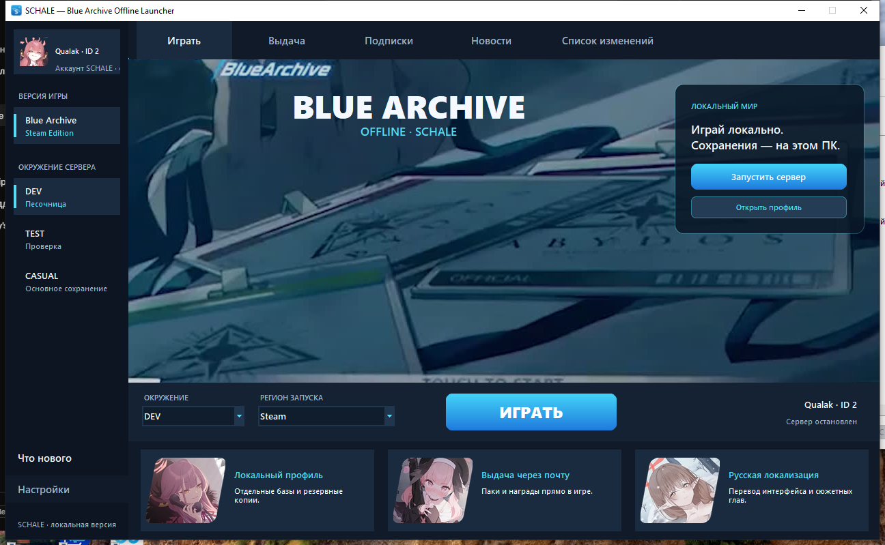
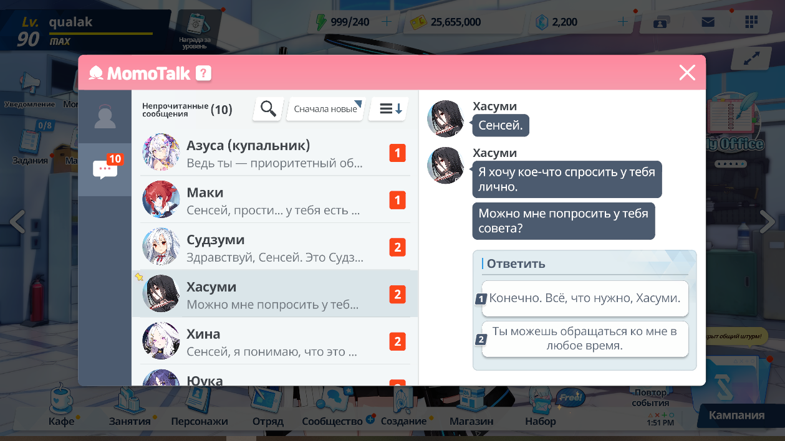

<div align="center">
  

  # SCHALE
  ### Локальный сервер и лаунчер для Blue Archive на Windows

  Оригинальный Steam-клиент. Локальные сохранения. Настраиваемое окружение.<br>
  Русская локализация и управление игровым сервером из одного приложения.

  <p>
    <a href="https://github.com/nober47747474/Blu-arhive-client-mod/releases/latest">
      
    </a>
    <a href="#установка">
      
    </a>
  </p>

  <p>
    
    
    
    
  </p>
</div>

---

## Что такое SCHALE?

**SCHALE** объединяет оригинальный клиент Blue Archive, локальный Shittim-сервер и удобный лаунчер. Награды, пакеты и подписки обрабатываются локально, без реальных покупок и Steam checkout.

> [!IMPORTANT]
> Это **не отдельная игра** и не полностью автономная версия клиента. Для запуска требуется установленная лицензионная Blue Archive и работающий Steam. Штатная проверка Steam не отключается.

> [!WARNING]
> **Безопасность аккаунта.** Мы не знаем, как издатель относится к локальным модификациям, и не можем гарантировать отсутствие блокировки или других санкций. Рекомендуется создать **новый отдельный Steam-аккаунт с Blue Archive** и не использовать основной. Это не гарантирует защиту от санкций.

## Возможности

| Раздел | Что доступно |
|---|---|
| **Локальные профили** | Раздельные базы DEV, TEST и CASUAL, резервные копии перед обновлениями |
| **Магазин** | Бесплатные пакеты и подписки через локальный сервер и игровую почту |
| **Подписки** | Просмотр сроков, продление и отмена прямо в лаунчере |
| **Регион запуска** | Steam, Google Play, App Store, One Store и Galaxy Store |
| **Наборы** | Recruitment Tickets, повторы персонажей, Recruitment Mileage и Recruit Stack |
| **Игровой процесс** | Локальная кампания, сохранение прогресса и журналы диагностики |
| **Русский язык** | Частичный перевод интерфейса, сюжета и диалогов MomoTalk |

Проект продолжает развиваться. Полная совместимость всех режимов и полный перевод пока не гарантируются.

## Русская локализация

Перевод выполняется вручную, с сохранением характера персонажей и связности диалогов. Уже переведены полные MomoTalk-ветки для Азусы в двух версиях, Маки, Судзуми, Хасуми, Хины и Юуки.

<div align="center">
  
</div>

## Установка

### 1. Подготовьте игру

Установите и обновите **Blue Archive** через Steam. Убедитесь, что используемый Steam-аккаунт имеет доступ к игре.

### 2. Скачайте установщик

Скачайте **`SCHALE-Setup.exe`** из [последнего релиза](https://github.com/nober47747474/Blu-arhive-client-mod/releases/latest) или воспользуйтесь [прямой ссылкой](https://github.com/nober47747474/Blu-arhive-client-mod/releases/latest/download/SCHALE-Setup.exe).

### 3. Установите SCHALE

Запустите установщик. Windows может запросить повышение прав для остановки игровых служб и настройки локального перенаправления.

### 4. Запустите локальный мир

1. Откройте SCHALE.
2. Выберите окружение и регион запуска.
3. Запустите локальный сервер.
4. Войдите в Steam и нажмите **«Играть»**.

> [!TIP]
> Не удаляйте папку `environments` при обновлении: в ней находятся локальные сохранения и резервные копии.

## Безопасность и конфиденциальность

- Пароли, токены и ключи аккаунта не собираются.
- Сохранения остаются на вашем компьютере.
- Локальное перенаправление использует **mitmproxy** и **WinDivert**.
- Корневой сертификат создаётся на компьютере пользователя во время установки; готовый приватный CA-ключ не входит в установщик.
- Не передавайте локальные сертификаты, конфигурации и базы сохранений другим людям.

## Проверка установщика

| Параметр | Значение |
|---|---|
| Файл | `SCHALE-Setup.exe` |
| Размер | **1 018 410 592 байта** |
| SHA-256 | `0e49617ad69b0ef677af4fedad476fc0f9def315de30b7609141e660fa66d8bf` |

Проверка хэша в PowerShell:

```powershell
Get-FileHash .\SCHALE-Setup.exe -Algorithm SHA256
```

## Правовая информация

SCHALE — независимый фанатский проект, не связанный с NEXON и NEXON Games. Blue Archive, связанные с ней персонажи и изображения принадлежат их правообладателям. Для использования проекта необходима лицензионная копия игры.
